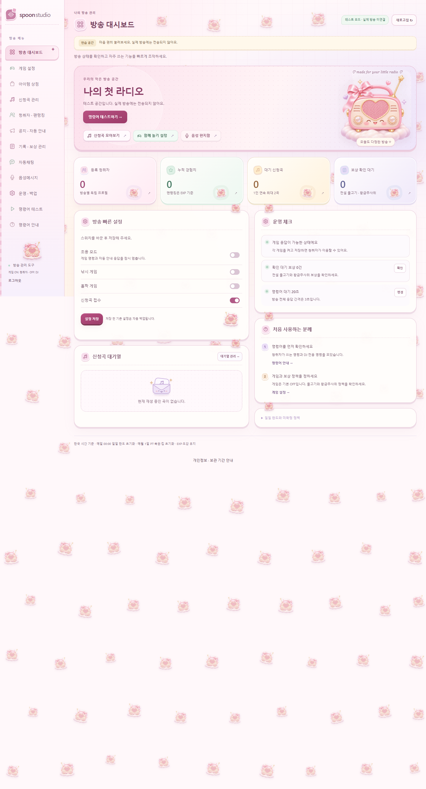

# Spoon Studio — 스푼 방송 봇

## 자동 실행 · 방송 운영 자동화

- Windows 로그인 시, 그리고 그 뒤 5분마다 작업 스케줄러가 짧은 실행기(`tools/managed-runtime.mjs`)를 돌려 관리자가 없으면 **콘솔 없는 별도 프로세스(`--daemon`)로 띄웁니다.** 관리자·서버·터널이 모두 숨은 콘솔에 매이지 않아 콘솔 창이 닫혀도 함께 죽지 않고, 관리자만 사라져도 서버·터널은 계속 돌며 다음 실행기가 새 관리자를 띄워 **떠 있는 서버·터널을 이어받습니다**(방송 연결이 끊기지 않음). 관리자는 15초 주기로 상태를 확인하고, 일시 장애 1회에는 재시작하지 않으며 연속 3회 실패 시 해당 프로세스만 복구합니다. 반복 장애에는 최대 5분 대기 시간을 적용합니다.
- 문제가 생기면 `deploy/automation.log`(관리자 시작, 종료 사유 `manager-signal:*`·`manager-exit:*`, 서버·터널 재시작), `deploy/automation-error.log`, `deploy/tunnel-out.log`, `deploy/public-error.log`(날씨 수집 실패 포함)와 DJ 화면 **진단**의 날씨 항목을 확인하세요. `node tools/managed-runtime.mjs`를 직접 실행하면 관리자를 띄우고 바로 끝납니다(디버깅은 `--daemon`).
- 고정 공용 주소: https://radiomate-mycom0216.gallanttamarind4.chatgpt.site — Sites의 중계 서버가 바뀐 임시 터널 주소를 서명된 요청으로 갱신합니다. 봇 DB·스푼/네이버/OpenAI 키는 PC에 유지하고 중계 서버에는 전달하지 않습니다. 로그인·음성 등 실제 HTTP 트래픽은 중계 주소를 거칩니다.
- 설치: `node tools/install-automation.mjs`. 예약 작업 등록이 허용되지 않으면 현재 사용자 시작프로그램 바로가기를 사용합니다. 해제: `node tools/install-automation.mjs remove`. 수면·PC 전원 OFF·로그아웃 중 상시 운영을 보장하지 않습니다.
- 설정 `deploy/automation.json`과 `deploy/gateway-router.key`는 Git에서 제외됩니다. 이 PC에 설정이 준비돼야 설치할 수 있습니다. 라우터 키는 고정 중계 서버의 `ROUTER_KEY`와 일치해야 합니다.
- DJ 관리 화면의 **운영 · 백업 → 자동 운영** 또는 `!자동운영 on / off / 상태`로 제어합니다. 자동 퀴즈 10분, 청취 복권 5분마다 1장·하루 100장, 출석·인사·신청곡 접수를 켭니다. 조용 모드는 존중하고 OFF 시 변경 전 설정을 복원합니다. 프로필 적용 후 DJ가 직접 수정한 값은 덮어쓰지 않습니다.
- `AUTO_OPERATIONS=1`이면 동의 토큰이 저장된 방송에 처음 한 번 프로필을 적용하며 신규 연결 방송에도 적용합니다. DJ가 OFF한 방송을 재시작 때 강제로 켜지 않습니다. 재동의가 필요한 스푼 권한 오류와 중복 봇 연결은 무한 재접속하지 않습니다.
- 음악은 재생 기기의 브라우저·앱과 최초 재생 허용이 필요합니다. 휴대폰 브라우저를 닫은 상태의 YouTube 재생이나 스푼 방송으로의 자동 오디오 송출을 제공하지 않습니다.

## 내일 · 이번 주 · 다음 주 전국 날씨

- `!전국날씨 내일`, `!전국날씨 이번주`, `!전국날씨 다음주` — 다음 페이지 번호는 응답 끝에 표시됩니다.
- `!이번주 전국날씨`, `!이번주 전국 내일 날씨`처럼 적어도 동작합니다. **내일이 명시되면 내일 날짜를 우선**합니다.
- `!전국날씨 다음주 화요일`, `!날씨 서울 다음주`, `!날씨 부산 내일` — 요일·지역별 상세 예보입니다.
- 화면의 날씨 조회 기간에서 현재·내일·이번 주·다음 주를 선택합니다. 주간 표는 17개 시·도의 일별 날씨·최저/최고 기온·강수확률을 표시합니다.
- 한국 시간 기준 월~일을 한 주로 봅니다. 이번 주의 지난 날짜는 서버가 저장해 둔 기상청 예보값(저장값이 없으면 Open-Meteo 모델 자료이며 채팅에 `과거=저장예보` / `과거=모델자료`로 표시)이고 관측값이 아닙니다. 응답이 누락된 날짜는 **예보 미제공**으로 표시합니다. 전국 주간 채팅 요약의 기온 범위와 강수확률은 17개 대표 지역의 최저/최고·최댓값 집계이며 모든 지역의 동일한 날씨를 뜻하지 않습니다.
- **날씨 출처는 기상청(KMA)입니다.** 네이버에는 날씨 공식 API가 없고(NAVER API HUB는 검색·검색어트렌드·쇼핑인사이트만 제공), 네이버 검색 화면을 읽어오는 방식은 약관·robots.txt 문제로 쓰지 않습니다. 대신 기상청 공식 자료를 씁니다.
  - 오늘~글피(4일): 기상청 1시간 단위 동네예보 RSS(`www.weather.go.kr/w/rss/dfs/hr1-forecast.do`, **서비스키 불필요**). 기상청은 알 수 없는 지역 코드에 오류 대신 `서울특별시 동작구 신대방제2동`을 돌려주므로 응답의 지역 표기까지 대조해 어긋나면 사용하지 않습니다. 기상청 안내 페이지에는 단기·중기 RSS 종료 공지(2025-03-31)가 있으나 2026-11-19 현재 이 주소는 응답합니다. 종료되면 아래 순서대로 Open-Meteo로 보충합니다.
  - 글피 이후(다음 주 등): 기상청 중기예보(`KMA_SERVICE_KEY` 설정 시). 키가 없으면 해당 날짜만 Open-Meteo 모델로 보충하고 `*`와 `기상청+Open-Meteo` 표기로 출처를 구분합니다.
  - **서비스키가 있으면 단기예보 API가 RSS의 예비 수집원입니다.** RSS가 실패하거나 종료되면 공공데이터포털 "기상청_단기예보 조회서비스"(`VilageFcstInfoService_2.0/getVilageFcst`)로 같은 모양의 자료를 만들어 쓰고, RSS는 30분 쉬었다가 다시 시도합니다(2026-11-19 실측: 17개 지역 모두 격자가 RSS와 일치, 내일·모레 값은 RSS와 동일). 이때 DJ 화면 **진단**에 "RSS 대신 단기예보 API로 받는 중"이라고 표시합니다.
  - 기상청 연결이 모두 실패하면 DB에 저장된 12시간 이내 스냅샷을 쓰고, 그것도 없으면 Open-Meteo로 보충합니다(Open-Meteo 연결은 기존처럼 보조 엔드포인트·5분 재시도). `WEATHER_SOURCE=openmeteo`로 예전 방식(Open-Meteo 전용)으로 되돌릴 수 있습니다.
  - **현재 기온은 서비스키가 있으면 초단기실황(관측값, `getUltraSrtNcst`)입니다**(채팅 출처에 `기상청 실황`, 비·눈이 관측 중이면 그 날씨로 표시). 날씨 상태(맑음·구름많음·흐림)는 실황에 없어 현재 시각의 동네예보를 함께 씁니다. 키가 없거나 실황을 못 받으면 예전처럼 현재 시각의 동네예보값(관측값 아님)입니다.
  - 오늘 최저·최고기온은 서비스키가 있으면 오늘 02시 발표분(`TMN`·`TMX`)으로 채워 하루 종일 확정값으로 표시합니다. 키가 없으면 새벽(02~05시) 발표분에만 들어 있어 서버가 1시간마다 수집해 DB에 기록하며, 그 시간에 서버가 꺼져 있었다면 오늘 최저·최고기온은 남은 시간 기준 값일 수 있고 이때는 채팅(`오늘은 남은 시간 기준`)과 화면(`남은 시간 기준`)에 그대로 표시합니다. 기상청 수집이 실패하면 처음 한 번(계속되면 6시간마다) `deploy/public-error.log`에 남기고 DJ 화면 **진단**에 경고로 보여 줍니다.

## 날씨 DB (SQLite)

기상청 연동과 함께 방송 데이터와 같은 `studio.sqlite`에 날씨 테이블 4개가 서버 시작 때 자동으로 만들어집니다(별도 마이그레이션 없음, 전체 백업에 포함).

| 테이블 | 역할 |
| --- | --- |
| `weather_location` | 조회 지역 마스터. `id`(표시 이름, 예: 서울), `zone`(기상청 행정구역 코드 10자리), `kma_name`(기상청 응답의 지역 표기, 검증용), 격자 `nx`·`ny`, 좌표 `lat`·`lon`, 중기예보 구역 `mid_land`·`mid_temp`, `national`(1=전국 목록 17곳), `enabled`, `managed` |
| `weather_alias` | 별칭 → 지역 (`수원`→경기, `전남광주통합특별시`→광주 등) |
| `weather_snapshot` | 기상청 응답 캐시(재시작·장애 대비). 지역별 최신 1건 |
| `weather_daily` | 일별 기록(최저·최고·강수확률·날씨·수집 시간 수). 지난 날짜 표시와 오늘 최저기온 보존에 사용하며 400일 보관 |

- `managed=1`인 행은 서버를 시작할 때마다 코드의 기준값으로 갱신됩니다(행정구역 개편 대응). 직접 고친 행은 `managed=0`으로 바꿔 두면 유지됩니다. `enabled=0`으로 조회에서 뺄 수 있습니다.
- 광주·전남은 2026-07 행정통합으로 코드가 `12…`로 바뀌어 반영했습니다. 지역을 추가·수정할 때는 먼저 코드가 그 지역이 맞는지 확인하세요: `curl -s "https://www.weather.go.kr/w/rss/dfs/hr1-forecast.do?zone=1224000000" | grep -m1 "<category>"` (잘못된 코드는 오류 없이 신대방제2동을 돌려줍니다).
- 추가 예: `INSERT INTO weather_location(id,zone,kma_name,nx,ny,mid_land,mid_temp,national,managed) VALUES('광양','1219000000','전남광주통합특별시 광양시',73,70,'11F20000','11F20402',0,0);` 이후 `!날씨 광양`으로 조회합니다(전국 목록에는 넣지 않습니다).
- 환경 변수: `WEATHER_SOURCE`(kma / openmeteo), `KMA_SERVICE_KEY`(선택, 공공데이터포털 한 키로 "기상청_중기예보 조회서비스"와 "기상청_단기예보 조회서비스"를 각각 활용신청해야 함: 중기예보 → 다음 주 이후, 단기예보 → RSS 예비·현재 기온 실황·오늘 최저/최고), `KMA_API_BASE`·`KMA_API_KEY_PARAM`(기본은 공공데이터포털 `serviceKey`, 기상청 API허브는 `authKey`). 중기예보 지점 코드는 2026-11-19에 전국 17곳과 추가 지역 4곳 모두 실제 응답으로 확인했습니다. 지역을 새로 추가할 때는 같은 방식으로 확인하세요.

## 사랑스러운 새 테마 · 채팅 · 날씨와 장소 검색

딸기우유·라벤더·크림 색상, 리본 장식과 기존 라디오 미니미를 활용한 Sugar Petal 테마를 적용했습니다. PC·모바일 공통 화면이며 배경 높이와 재생 전 로그아웃 오류도 수정했습니다.

- **AI와 대화**: OpenAI Responses API로 자유로운 대화, 최근 6쌍 문맥, 대화 초기화. 스푼에서는 `!채팅 질문` / `!대화 질문`, `!채팅 초기화`를 사용합니다. 질문·최근 대화만 전송하며 스푼 토큰이나 청취자 목록은 보내지 않습니다. AI 문맥은 마지막 성공 답변부터 30분 동안 서버 메모리에 보관합니다. 스푼으로 보내는 답변은 기존 전송 기록에 최대 7일간 남으며 중복 확인용 이벤트에는 응답 본문을 저장하지 않습니다.
- **AI 호출 제한**: 방송당 하루 100회(KST, 실패한 요청도 포함), 사용자당 10초, 서버 동시 4건·하루 1,000회. 서버 전체 제한은 재시작 시 초기화됩니다. 결제 금액 상한은 아니므로 OpenAI 프로젝트에서도 예산을 설정하세요. API 키가 없으면 미설정 안내를 표시합니다. 공개 방문자 테스트 공간에서는 실제 AI 호출을 차단합니다.
- **앱 방송 채팅방**: DJ가 입장 링크 열기·닫기·갱신, 메시지 삭제를 할 수 있습니다. 청취자는 링크로 참여하며 손님 이름은 스푼 인증 이름이 아닙니다. 스푼 채팅과 별도 공간이고 자동 전송하지 않습니다. 2초 전송 제한, 400자, 최근 100개·7일 보관(정리 작업은 최대 6시간 지연), 방송별 격리를 적용합니다. `!채팅방`으로 열어둔 주소를 안내합니다.
- **전국 날씨**: `!전국날씨 1` / `2` / `3`, `!날씨 서울`. 화면에서는 전국 17개 시·도의 대표 지점을 한 번에 표시합니다. 기상청 동네예보의 현재 시각 예보값(10분 캐시)이며 읍·면·동 관측값이 아닙니다. 목포·여수·순천·서귀포는 전국 목록 밖에서 이름으로 따로 조회합니다(예: `!날씨 목포`).
- **맛집·카페**: `!맛집 광주 점심`, `!맛집 부산 아침`, `!맛집 서울 저녁`, `!카페 광주 동명동`. 네이버 지역 검색 API의 관련도 순 최대 5곳을 화면에서 표시합니다. 별점·영업시간·가격을 만들어내지 않으며 방문 전 확인이 필요합니다. 키 미설정 시 지도 검색 링크를 제공합니다.
- **설정**: 운영 PC에서 `node tools/configure-services.mjs` 실행 후 표시되는 `127.0.0.1` 주소를 엽니다. NAVER API HUB의 지역 검색 Client ID·Secret과 OpenAI 키를 직접 입력하면 각 제공자와 연결 확인 후 무시된 `deploy/temporary.env`에 저장합니다. 짧은 OpenAI 확인 호출 1회가 발생합니다. 저장 후 해당 설정 파일로 서버를 다시 시작하세요. 인증키를 채팅·저장소에 올리지 마세요.
- **네이버 신규 등록**: 2026년 7월 31일 이후 신규 검색 API는 NAVER API HUB에서 신청합니다. Maps 키와 별도이며 Application에서 NAVER 검색의 지역을 선택해야 합니다. 기존 Developers 검색 키는 설정창에서 legacy 방식을 선택할 때만 사용합니다. 지역 검색 결과를 AI 문맥에 넣지 않고 별도 화면에 표시합니다.
- **제공자 문서**: [NAVER API HUB 지역 검색](https://api.ncloud-docs.com/docs/naver-api-hub-search-local), [네이버 지역 검색](https://developers.naver.com/docs/serviceapi/search/local/local.md), [기상청 날씨누리](https://www.weather.go.kr/), [Open-Meteo](https://open-meteo.com/en/docs), [OpenAI Responses API](https://developers.openai.com/api/reference/resources/responses/methods/create). Open-Meteo 무료 공개 API는 비상업 용도입니다. 상업 운영 전 제공자 요금제와 이용 조건을 확인하세요.

## 프로젝트 문서와 발표 자료

[2026년 11월 18일 최종 산출물](docs/deliverables/20261118/README.md)에 요구사항분석서·명세서, 데이터정의서, 개발일정표, 포트폴리오, 발표 PPTX와 상세 순서도를 모았습니다. Word 5종의 PDF, 물리/JSON 논리 ERD PNG·SVG, Android 로그인·직접 배포 흐름을 포함합니다. 기준 코드는 `c572bf8`이며, 편집 파일과 검수 결과를 함께 제공합니다.

## Android 앱

설치형 Android 앱을 `android/`에 추가했습니다. **Android 8.0 이상**에서 기존 HTTPS 서버의 관리 화면을 사용합니다. DJ 연결은 기본 브라우저에서 동의한 후 일회용 코드와 앱 검증값으로 세션을 교환합니다. Spoon 비밀키는 앱에 포함하지 않습니다.

- 실행 중인 서버의 `/android` 페이지에서 서명 APK를 내려받습니다. 운영자가 `output/android/RadioMate-1.0.0.apk`를 배치해야 다운로드할 수 있습니다.
- 서버 주소 변경, 뒤로가기, 새로고침, 음성 파일 선택·마이크 권한, 파일 저장을 지원합니다.
- `tools/build-android.ps1`로 서명 APK·AAB를 다시 빌드합니다. [설치·서명·Play 배포 준비 안내](android/README.md)를 참고하세요.
- 서버 PC와 HTTPS 터널은 계속 운영해야 합니다. 앱 종료 후 YouTube 재생 유지나 스푼 방송으로 자동 송출하는 기능은 제공하지 않습니다.

## 아이템 구매

- `!아이템 상점`: 아이템 이름·ID·가격과 구매 방법. 길면 `!아이템 상점 2`로 다음 페이지를 확인합니다.
- `!구매 rare`, `!아이템 구매 1`, `!구매 희귀 물고기 확률 UP`처럼 ID·번호·정확한 이름으로 구매합니다. PT를 차감하고 가방에 한 개 보관합니다.
- 구매 응답에 차감 금액·남은 PT·보유 개수·사용 명령을 표시합니다. 예: `!아이템 사용 rare`. 구매와 사용은 별도이며 효과는 사용 후 적용합니다.
- 부족한 PT·품절·판매 중지·중복 이름은 차감 없이 안내합니다. 재고와 이벤트 중복 처리를 유지합니다. 구매·가방·아이템 사용은 게임의 긴 개인 대기시간과 분리하되 전체 응답 간격과 1초 개인 제한은 적용합니다.

## 애청지수 상승 안내

- 방송 중 확인된 청취자에게 5분 간격으로 최근 증가분과 누적 자체 지수를 안내합니다. 예: `콰앙님 +5° → 25°`. 1점=1° 표시이며 **스푼 공식 애청온도와 다릅니다**.
- 계산은 청취 1분당 1점, 매시간 첫 채팅 5점으로 유지합니다. 여러 명의 안내는 한 메시지에 묶어 보내며, 복권 일일 한도와 별도로 동작합니다.
- `!애청지수`로 현재 값·최근 집계 상승분·청취 시간·채팅 기여를 조회합니다. 게임 설정의 **애청지수 상승 자동 안내**에서 끌 수 있습니다. 처음 확인한 시점부터 집계하며 연결 실패·부재 시간은 청취로 인정하지 않습니다.

## 청취자 킵 사용 · 취소 · 월말 만료

- DJ와 청취자 모두 `!킵`으로 자신의 보유 보상을 조회합니다. 프로필이 없으면 자동 생성합니다.
- `!킵 사용 1` 또는 `!킵 사용 보상명`: 보상 1개를 즉시 보유 목록에서 빼고 사용 완료 내역에 기록합니다. 같은 보상이 여러 개면 1개만 사용합니다.
- `!킵 완료`: 사용 완료 목록. `!킵 취소`는 가장 최근 본인 사용을 되돌리며, `!킵 취소 1` 또는 `!킵 취소 보상명`으로 특정 내역을 복원할 수 있습니다. 같은 내역은 한 번만 복원합니다. DJ가 처리한 사용은 DJ에게 취소를 요청하세요.
- 유효기간은 **획득한 달의 말일 23:59:59까지(한국 시간)**입니다. 다음 달 1일 00:00부터 보유 킵을 초기화하며 지난달 사용 내역은 취소·복원할 수 없습니다. 서버가 꺼져 있었다면 다음 실행·조회 시 초기화를 적용합니다. 완료·취소 이력은 기록으로 보관합니다.
- 킵 명령은 게임의 긴 개인 대기시간과 분리했습니다. 방송 전체 응답 간격과 킵 연속 요청 제한은 적용합니다. 관리 화면은 입력 중이 아닐 때 변경된 목록을 주기적으로 갱신합니다.

## 2026-11-18 설치형 웹앱과 자동 퀴즈

- 공용 HTTPS 주소를 Safari/Chrome에서 연 뒤 상단 **모바일 앱처럼 사용하기**를 확인하세요. 아이폰은 공유 → 홈 화면에 추가, 안드로이드는 메뉴 → 앱 설치 또는 홈 화면에 추가로 실행합니다. 설치 후 DJ 연결이 다시 필요할 수 있습니다.
- **접수 즉시 이 기기에서 자동재생 시도**를 기본으로 켰습니다. 화면이 열려 있고 현재곡·별도 선택곡이 없으면 새 신청곡을 약 4초 내에 감지해 재생을 시작합니다. `!재생`은 필요하지 않으며, 최초 브라우저 재생 허용이 필요할 수 있습니다. 일시정지·`!멈춤` 상태는 자동으로 해제하지 않습니다. 여러 기기 중 재생할 한 곳에서만 켜세요.
- 웹앱은 서버를 대신하지 않습니다. 임시 HTTPS를 사용하는 동안 서버 PC와 터널이 켜져 있어야 하며 주소가 바뀌면 새 주소로 다시 설치해야 합니다.
- YouTube는 화면 밖 재생을 허용하지 않습니다. 앱 전환·잠금·종료 시 멈추며, 돌아와 **재생 시작 / 이어서 재생**을 누르면 같은 방송·현재곡·영상에 한해 마지막 위치를 복원합니다. 이 브라우저에 저장한 위치는 12시간 동안 유효하며 만료 후 조회·재생 완료·로그아웃 시 지웁니다. 설치만으로 백그라운드 재생이나 스푼 방송 송출이 생기지 않습니다. [공식 정책 III.I.9](https://developers.google.com/youtube/terms/developer-policies#i.-additional-prohibitions)
- 게임 설정의 **방송 중 자동 퀴즈 출제**와 간격(기본 10분)을 저장하거나 DJ가 `!자동퀴즈 on 10`을 입력하세요. 명령으로 켜면 다음 스케줄 점검부터 출제를 시도합니다. `!자동퀴즈 상태`, `!자동퀴즈 off`를 지원합니다.
- 자동 퀴즈는 방송 중에만 출제하고, 조용 모드·응답 간격을 지킵니다. 개인 문제를 푸는 중이면 기다리며, 첫 정답자 한 명에게만 기존 확률에 따라 EXP/복권을 지급합니다. 5분 동안 정답자가 없으면 초성·분류 힌트와 정답·뜻을 한 메시지로 공개하고, 종료 후 지정 간격을 기다려 새 문제를 냅니다. 한 바퀴를 돌기 전 같은 문제를 다시 내지 않습니다.
- 오프라인에서는 안내 화면만 제공합니다. 로그인·방송 설정·음성 파일·OAuth 응답은 서비스 워커 캐시에 저장하지 않습니다.
- 자동 테스트 **158개 통과**. 실제 모바일 설치·마이크·기기 오디오와 실방송 자동 퀴즈 송신은 자동 테스트와 구분합니다. [이번 검증 기록](docs/웹앱-자동퀴즈-2026-11-18.md)

## 2026-11-17 원격 점검 및 추가 기능

- [점검·수정 기록](docs/원격점검-수정내역.md): 재고 저장 경합, 다음 곡 표시, 중간 너비 입력칸 넘침, 요청 시간 초과·오류 안내와 메뉴 이동을 수정했습니다. 자동 테스트 75개가 통과했습니다.
- 명령어 안내에서 기능·명령어 검색을 지원합니다.
- [청취자 전용 음성 입력 확장](extensions/listener-voice/README.md)을 추가했습니다. DJ 관리 화면과 별도로, 개인 청취자가 PC 스푼 웹의 입력창에 말한 내용을 넣는 기능입니다. 실제 전송은 스푼에서 직접 합니다.
- 실행 중 [청취자 화면 미리보기](http://localhost:4310/listener/)와 [설치·사용 안내](http://localhost:4310/listener/guide.html)를 열 수 있습니다. 로컬 페이지 자체가 다른 사이트의 입력창을 조작하지는 않으며, 확장 설치가 필요합니다.
- 확장 설치·실제 마이크 인식·로그인된 스푼 계정의 입력·전송은 실환경 확인이 필요합니다. 기존 프로젝트 문서 5종과 함께 위 점검 기록을 참고하세요.


PC·모바일 반응형 관리 화면, SQLite 기반 방송별 데이터 저장, 스푼 공식 OAuth/SSE 연결을 제공합니다. 실제 DJ 로그인·연결 화면과 임시 HTTPS 접속을 확인했습니다. 상시 클라우드 서버 배포와 모든 실기기 기능 검증은 별도입니다. 최신 상태는 위 검증 기록을 참고하세요.


## 이 PC에서 실행

Node.js 24 이상이 필요합니다. 외부 npm 패키지는 사용하지 않습니다.

1. `시작하기.cmd`를 실행하거나 이 폴더에서 `npm start`를 실행합니다.
2. 브라우저에서 <http://localhost:4310>에 접속합니다.
3. **먼저 테스트해 보기**를 누릅니다. 이 모드는 실제 방송과 연결되지 않습니다.
4. `!내정보 생성` → 20초 대기 → `!출석` → 20초 대기 → `!복권 3 6 9`를 테스트합니다.
5. 게임 설정에서 낚시를 ON으로 저장한 뒤 테스트합니다. 테스트도 동일한 대기시간·보상 한도를 적용합니다.

다른 기기의 실제 접속에는 공용 HTTPS 서버가 필요합니다. 로컬 테스트 로그인은 이 PC에서만 가능합니다. 프로그램을 종료하면 로컬 봇도 중지됩니다.

## 관리 화면 사용



딸기우유 분홍·라일락의 Petal Radio 테마, 리본·진주 다이얼·하트 스피커 라디오 일러스트, SVG 메뉴 아이콘, 스티커 느낌의 요약 카드, 아바타 말풍선 채팅과 반응형 메뉴를 제공합니다.

- 대시보드의 통계 카드를 누르면 청취자, 신청곡, 보상 관리 화면으로 이동합니다. 방송 빠른 설정은 스위치를 바꾼 뒤 저장해야 적용됩니다.
- 입력 중에는 하단에 미저장 변경사항이 표시됩니다. 메뉴 이동·새로고침·로그아웃 시 변경사항을 버릴지 확인하며, 변경 취소로 마지막 저장 상태를 불러올 수 있습니다.
- 로컬 테스트 모드의 **명령어 테스트** 메뉴에서 명령을 보냅니다. 빠른 명령어와 **명령어 안내**의 테스트 버튼은 입력창만 채우며, 전송을 눌러야 실행됩니다. 테스트 결과와 상태가 갱신되고 대화는 현재 페이지 세션에서 최대 100개 메시지를 유지합니다.
- 청취자는 닉네임·고유 ID로 검색하고, 최근 활동 기록 200건은 청취자·종류·내역으로 검색할 수 있습니다. 검색은 화면에 불러온 목록을 대상으로 합니다.
- 공지 초안 생성은 설정을 저장하지 않습니다. 작성한 제목·접수 여부로 미리 본 후 자동 안내에 추가하고 저장하세요.
- 신청곡이 없을 때 다음 곡 버튼은 비활성화됩니다. 서버도 빈 대기열 이동을 거부하므로 기존 현재곡이 유지됩니다.
- 백업 목록은 해당 방송의 최근 20개 설정 백업을 표시합니다. 전체 DB 백업과는 별개입니다.

화면은 PC 사이드 메뉴와 모바일 가로 메뉴를 지원합니다. 390px 모바일 너비에서 전체 메뉴의 페이지 가로 넘침을 확인했으며, 긴 표는 표 안에서 가로로 스크롤합니다. 실제 모바일 기기와 스푼 방송 연결은 별도 검증이 필요합니다.

## 추가 기능 사용

- 복권 지급은 `!복권지급 @콰앙 3`, `!복권지급 @콰 3`처럼 표시 닉네임 전체·일부로 가능합니다. 정확히 일치하는 이름을 우선하며 부분 일치가 여러 명이면 더 긴 이름을 요청합니다. 내부 고유 ID도 지원합니다. 계정 ID·이메일은 공식 API에서 조회할 수 없어 **청취자 · 팬랭킹 → 계정 ID·이메일 비공개 연결**에서 DJ가 한 번 연결한 뒤 사용합니다. 이메일은 서버 키를 이용한 해시만 저장합니다. 실제 스푼 이메일 소유 여부를 검증하는 기능은 아닙니다. 개인정보는 공개 채팅 대신 관리 화면의 지급 입력란을 이용하세요.

- DJ의 `!이전곡`·`!다음곡`은 서버에서 곡을 선택하며 `!재생`·`!멈춤`도 PC 관리 화면 없이 요청을 기록합니다. 제목 검색도 서버에서 처리합니다. 실제 소리는 로그인한 휴대폰·태블릿·PC의 `/player` 화면 중 한 기기에서 재생합니다. **재생 장치 없이 음악을 스푼 방송에 송출하는 기능은 제공하지 않습니다.** 첫 재생은 브라우저 정책에 따라 버튼 조작이 필요하며, 재생 기기의 브라우저를 닫으면 소리가 멈춥니다.
- 신청곡은 `!신청곡목록`에서 1번부터 가수·곡명과 신청자 닉네임을 조회합니다. 시작한 곡은 대기열에서 빠지고 종료·전환 시 최근 100곡 완료 기록에 남습니다. **`!삭제` → `1`**, **`!삭제 2`**로 번호 삭제하며 삭제 후 다시 1번부터 정렬합니다. `!이전곡 삭제`·`!다음곡 삭제` 다음에 가수·곡명을 입력하거나 `!다음곡 삭제 아이유`처럼 한 줄로 입력할 수도 있습니다. 선택은 2분간 유지되고 `!삭제 취소`로 취소합니다. 목록이 바뀌면 잘못된 번호로 삭제하지 않고 새 목록을 안내합니다. 삭제한 곡은 같은 영상·제목의 대기·이전곡·완료·영상 기억·되돌리기 상태에서 함께 제거하여 다시 선택되지 않습니다. 새로 직접 신청하는 것은 허용합니다. 청취자는 `!신청취소`로 본인 대기곡을 취소합니다.
- `!퀴즈`는 `초성: ㅎㄱ (힌트: 건물)`처럼 개인별 문제를 냅니다. 기본 제한은 30분이며 정답 시 **50% 확률로 50 EXP, 50% 확률로 복권 1장**을 지급합니다. 확률·보상·문제 분류·정답 뜻은 게임 설정에서 변경할 수 있습니다. 정답 성공·포기·시간 종료 시 정답과 뜻을 공개하며 시간 종료 안내는 방송 연결 중 서버가 처리합니다. 같은 회차는 중복 지급하지 않습니다.
- 청취 보상은 **5분마다 복권 1장, 하루 최대 100장**입니다. `listeners.read` 동의 후 1분 간격으로 전체 청취자 목록을 확인하여 연속 확인된 시간만 적립합니다. 서버 중단·목록 실패·90초 이상 공백은 제외하며 조회 사이의 짧은 퇴장·재입장은 구분하지 못할 수 있습니다. 내부 애청지수는 **확인된 청취 1분당 1점 + 매시간 첫 채팅 5점**입니다. `!랭킹`·팬랭킹 화면은 애청지수 순서, `!경험치랭킹`은 EXP 순서입니다. 스푼 공식 애청온도나 공식 순위를 변경하지는 않습니다. 출석 보상은 별도로 **한국 시간 하루 한 번 복권 20장**입니다.
- `!보이스카드`는 짧은 `/v/` 접수 주소를 안내합니다. 기존 `/voice/` 주소도 사용할 수 있습니다. 스푼 내장 브라우저에서 열리지 않으면 Safari·Chrome에 주소를 붙여넣으세요. 임시 HTTPS는 PC·서버·터널 실행 중에만 접속할 수 있습니다.
- `!신청곡 https://youtu.be/영상ID [곡 제목]`으로 YouTube 영상을 신청합니다. watch·shorts·live 링크도 지원하며 같은 영상의 URL 형식이 달라도 중복을 감지합니다. 제목만 신청한 곡도 서버에 `YOUTUBE_API_KEY`가 설정되어 있으면 재생 시 공식 Data API로 검색합니다. 음원은 다운로드하지 않습니다.
- 신청곡 옆 **이 곡 재생**을 누르면 해당 곡이 현재곡으로 바뀌고 상단 플레이어에서 재생됩니다. 연결했던 영상은 방송별로 기억해 같은 제목의 다음 신청에 재사용합니다. 검색 결과가 다른 버전이면 **영상 연결·변경**으로 교체할 수 있습니다.
- Windows 임시 공용 서버는 `YouTube설정.cmd`로 검색 키를 확인·저장·적용할 수 있습니다. Google Cloud에서 YouTube Data API v3를 활성화하고 키 사용 범위를 해당 API로 제한하세요. 키는 채팅과 GitHub에 올리지 마세요.
- 신청곡 관리의 **재생 시작**으로 첫 재생을 시작합니다. **끝나면 다음 곡 자동재생**을 켜면 영상 종료 시 다음 신청곡으로 넘어갑니다. 플레이어는 메뉴를 이동해도 유지됩니다. 자동 전환은 현재곡 ID를 비교하여 중복 종료 이벤트나 여러 탭이 대기열을 여러 곡씩 넘기지 않도록 합니다.
- 실제 소리는 이 브라우저에서만 나옵니다. 방송 송출은 사용 중인 송출 프로그램의 오디오 입력을 연결해야 합니다. 브라우저를 닫으면 재생이 멈춥니다. 첫 재생과 브라우저의 자동재생 차단은 사용자 클릭이 필요하며, 임베드 금지·비공개·삭제 영상이나 링크 없는 곡은 건너뛰지 않고 멈춥니다.
- 청취자의 `!룰렛` 당첨 보상은 킵에 자동 등록됩니다. 같은 보상은 수량으로 묶어 표시하고, **꽝은 보유 킵에 포함하지 않고 사용내역으로 분리**합니다. DJ가 킵을 사용 처리하면 보유 수량을 1개 줄이고 사용 기록을 남깁니다. 기존 월초 보유 킵 초기화 규칙은 유지하며 사용내역은 보존합니다.
- **공지 · 자동 안내**에서 좋아요 인사를 설정합니다. `events.like` 권한이 필요하므로 기존 스푼 연결은 다시 동의해야 합니다. 무료 탭 하트(양수, combo=null)에 대해 청취자 ID별로 10분에 한 번 인사하고, 조용 모드와 전체 응답 간격을 적용합니다. 실제 전송에 성공했을 때만 10분 간격을 기록합니다.
- 프로그램 소개 멘트는 방송 연결 후 10분부터 전송하며, 성공 시점부터 다음 10분을 계산합니다. 문구와 사용 여부는 DJ가 변경할 수 있습니다. 방송 종료·조용 모드에는 보내지 않으며, 별도 자동 안내와 동시에 예정되어 있으면 전체 응답 간격에 맞춰 나누어 보냅니다.

공식 연동 참고: [YouTube IFrame API](https://developers.google.com/youtube/iframe_api_reference), [스푼 좋아요 이벤트](https://developers.spooncast.net/docs/en/api-reference/live-events#like--hearts).
청취 자동 보상은 [스푼 현재 청취자 목록 API](https://developers.spooncast.net/docs/en/api-reference/listeners)의 페이지와 `listeners.read` 권한을 사용합니다.

공식 앱 내부 조작에는 제한이 있습니다. [공식 봇 API 목록](https://developers.spooncast.net/docs/en/api-reference/endpoints)에는 녹음창·충전창 실행, 방송 음악 송출, 이메일 조회, 다른 DJ의 동의 없는 방송 입장 기능이 없습니다. `!보이스카드`는 공용 HTTPS 녹음 페이지를 안내하며 `!스푼`은 `/스푼` 입력 방법과 공식 충전 링크·조건 확인 안내를 제공합니다. `!라디오메이트`·`!봇호출`은 연결 상태와 연결 방법을 알려줍니다. 새 DJ는 공용 화면에서 본인 스푼 계정으로 동의해야 하며 이후 방송 시작 시 봇이 자동 접속합니다. 현재 임시 HTTPS는 서버와 터널을 실행한 PC가 켜져 있는 동안만 사용할 수 있습니다. 상시 운영에는 별도 서버 배포가 필요합니다.

정상 DJ 로그인은 기존 12시간 만료를 유지하면서 암호화 저장해 서버 재시작 후에도 유지합니다. 공개 테스트 로그인은 메모리에만 보관하여 재시작 시 초기화합니다. 세션 지속 기능 적용 전에 만들어진 로그인은 한 번 다시 연결해야 합니다. 초기 설계 문서보다 이 README와 최신 검증 기록의 운영 규칙이 우선합니다.

- `!스푼`은 안내 문구와 공식 충전 링크를 함께 반환합니다. 청취자·DJ 모두 프로필 없이 조회할 수 있으며 링크를 눌러 이동합니다. 모바일 앱이나 웹에서 `/스푼`을 대신 실행하거나 개인 화면을 자동 전환하는 기능은 공식 봇 API에 없어 제공하지 않습니다. 할인 조건과 최종 금액은 공식 화면에서 확인하세요.

## 자동채팅·미니게임·음성메시지

### 자동채팅

관리 메뉴 **자동채팅**에서 키워드 규칙과 주기 문구를 설정합니다. 키워드는 정확히 일치 또는 포함으로 비교하며 대소문자·전각 문자 차이를 정규화합니다. 기본 명령어가 우선이고, 프로필이 없는 청취자도 키워드 응답을 받을 수 있습니다. 규칙별 대기시간은 방송 전체에 적용하며 한 채팅에는 한 번만 응답합니다. `{name}`은 청취자 닉네임으로 치환됩니다.

주기 문구는 한 줄에 하나, 각 200자·최대 30개이며 순차 또는 무작위로 발송합니다. 1~1440분 간격, 방송 중에만 동작하고 조용 모드·전체 응답 간격을 적용합니다. 새 설정은 저장한 뒤 다음 스케줄러 실행에서 예약하고, 전송 성공 후 다음 간격을 계산합니다. 기존 프로그램 소개와 자동 안내는 별도 기능입니다.

### 미니게임

게임 설정의 미니게임은 기본 OFF입니다. `!가위바위보 가위/바위/보`, `!주사위` 또는 `!주사위 1~6`, `!숫자맞히기 1~100`을 지원합니다. 숫자맞히기는 개인별 7회 제한이며 `!숫자맞히기 초기화`로 다시 시작할 수 있습니다. PT·EXP는 지급하거나 차감하지 않고 개인 명령어 대기시간과 조용 모드를 적용합니다. 청취자는 `!게임 on`을 사용할 수 있으며, `!게임 off`는 DJ만 사용할 수 있습니다. 게임 ON/OFF 명령은 낚시·홀짝·세 미니게임을 함께 제어합니다. 룰렛은 보상 설정이 필요해 별도로 켭니다.

### 별도 음성메시지 접수함

스푼 공개 API에는 보이스카드 발송 엔드포인트가 없어, 이 기능은 **스푼 앱 보이스카드함과 별개**입니다. 팬 관계를 확인하거나 요구하지 않습니다. 청취자 이름은 직접 입력한 이름이며 스푼 계정 소유 인증은 아닙니다.

1. DJ가 **음성메시지 → 접수 시작·링크 만들기**를 누릅니다. 기본은 접수 중지입니다.
2. 링크를 공유하거나 청취자가 `!보이스카드`로 링크를 조회합니다. `localhost` 주소는 같은 PC에서만 열리므로 다른 기기에서 받으려면 공용 HTTPS 서버에 배포해야 합니다.
3. 청취자는 최대 60초 녹음 또는 MP3·WAV·M4A·WebM·Ogg 파일(8MB 이하)을 선택하고 미리 들은 뒤 직접 전송합니다. 녹음은 마이크 권한과 HTTPS 또는 localhost 보안 컨텍스트가 필요합니다. 지원하지 않는 환경에서는 파일을 선택할 수 있습니다.
4. DJ 수신함에서 재생하면 읽음으로 표시됩니다. 읽음/안 읽음 처리와 영구 삭제를 지원합니다. 접수 중지는 기존 링크를 닫고, 새 링크로 변경하면 이전 링크가 무효가 됩니다.

음성 파일은 `data/voice`에 저장하며 파일 조회는 해당 DJ 로그인 세션으로 제한합니다. 공개 접수 링크는 이름·제목·오디오를 등록할 수 있지만 수신함이나 기존 파일은 조회할 수 없습니다. 전송 요청 ID로 재시도 중복을 방지하고 컨테이너 헤더를 검사합니다. 포맷을 완전히 디코딩하는 서버 검증은 아니므로 브라우저에서 미리 재생해 확인하세요.

방송별 최대 100개·100MB, 서버가 보는 같은 접속 IP에서 10분에 5건을 제한합니다. 프록시·공유망에서는 한도를 공유할 수 있습니다. 메시지는 DJ가 삭제하기 전까지 보관하며 설정 백업에는 포함되지 않습니다. 전체 `data` 백업에는 DB와 음성 폴더를 함께 포함하세요. 실제 스푼 송신·마이크 장치·인터넷 공개 배포는 별도 검증 대상입니다.

공식 범위: [스푼 API 목록](https://developers.spooncast.net/docs/en/api-reference/endpoints). 녹음 API: [MediaRecorder](https://developer.mozilla.org/en-US/docs/Web/API/MediaRecorder), [getUserMedia](https://developer.mozilla.org/en-US/docs/Web/API/MediaDevices/getUserMedia).

## 스푼 연결 준비

별도 봇 계정으로 [Spoon Developers](https://developers.spooncast.net/docs/en/getting-started/app-registration)에 앱을 등록하고 필요한 API 이용 승인 절차를 완료하세요. DJ가 자신의 계정으로 동의하면 그 DJ의 방송만 연결됩니다.

`.env.example`을 `.env`로 복사하고 다음 값을 설정합니다. 비밀 키는 채팅이나 소스 저장소에 올리지 마세요.

```dotenv
PUBLIC_URL=https://your-domain.example
SPOON_CLIENT_ID=개발자센터의_Client_ID
SPOON_CLIENT_SECRET=개발자센터의_Client_Secret
TOKEN_KEY=32바이트를_64자리_hex로_표현한_값
NODE_ENV=production
HOST=0.0.0.0
PORT=4310
```

- 지역: 개발자 앱을 등록한 지역에 맞춰 `SPOON_REGION=kr`(한국, 기본) 또는 `jp`(일본)를 설정합니다. 로그인 주소(`/kr` 또는 `/jp`)와 API 서버(`kr-openapi`/`jp-openapi`)가 함께 바뀝니다. 한 서버는 한 지역만 지원하며, DJ 계정의 지역이 앱 지역과 다르면 방송을 찾지 못합니다.
- 개발자센터 Redirect URI: `https://your-domain.example/oauth/callback`
- 요청 scope: `me.read events.chat chat.send events.presence events.like events.donation`
- 입장 이벤트 수신에는 봇 계정을 방송 매니저로 지정해야 합니다. 채팅/후원 권한과 별개입니다.
- `node -e "console.log(require('node:crypto').randomBytes(32).toString('hex'))"`로 TOKEN_KEY를 생성할 수 있습니다. 생성한 키를 보관하세요. 이 키를 잃으면 저장된 토큰을 복호화할 수 없습니다.
- 접속 토큰은 AES-256-GCM으로 암호화해 DB에 저장하고, refresh token 교체 결과를 저장합니다.
- 스푼 OAuth code는 한 번만 교환합니다. 네트워크 오류 때 같은 code를 재시도하지 않습니다.

## 24시간 운영

이 프로젝트는 지속 연결과 SQLite 파일이 필요하므로 **상시 실행되는 Node 서버 + 영구 저장 볼륨**에 배포합니다. 정적 웹 호스팅만으로는 봇이 실행되지 않습니다.

```sh
docker compose up -d --build
docker compose logs -f
```

앞단에 HTTPS 리버스 프록시를 구성하고 PUBLIC_URL을 맞추세요. compose는 호스트 loopback 4310에만 노출합니다. 서버 비용·도메인·개발자 앱 정보는 제공되지 않아 이 작업에서 실제 호스팅을 생성하거나 결제하지 않았습니다.

하나의 서버 프로세스가 여러 DJ를 관리합니다. **같은 DB에 여러 봇 인스턴스를 동시에 띄우지 마세요.** API는 DJ당 SSE 연결 1개를 요구합니다. 대규모 서비스로 확장할 때는 워커 소유권 잠금과 중앙 DB로 전환해야 합니다. 현재는 소규모 파일럿용입니다.

서버 재시작 시 데이터·토큰은 유지하고 웹 로그인 세션은 종료됩니다. 오프라인 중 수신하지 못한 채팅/후원 이벤트는 소급 재생하지 않습니다. 한도 및 초기화는 5초 주기와 각 요청에서 한국 날짜 기준으로 적용되므로 재시작·장애 뒤에도 누락된 월 초기화를 반영합니다.

## 확정 규칙

- EXP: 팬랭킹 기준, 월 초기화 없음. 낚시 60 EXP/회, 2배 아이템 적용 중 120 EXP/회, 낚시 EXP 일일 20만. 복권 EXP는 별도.
- PT: 게임머니·상점용. 낚시 하루 20만, 홀짝 당첨 이익 하루 50만. 전체 게임+전설 특별 보상 하루 100만. 초과분 미지급. 일반 DJ 수동 지급 제외.
- 상점에서 소비해도 일일 누적 획득 한도는 다시 열리지 않습니다. 홀짝 패배는 당일 누적 당첨 이익을 낮추지 않습니다.
- 한국 시간 자정 일일 초기화. 매월 1일 PT·복권·킵 초기화. EXP·도감·거래 기록 유지. 아이템 재고는 월 초기화 대상에 포함하지 않았습니다.
- `!출석`은 DJ 권한 없이 청취자가 사용하며, 프로필 생성 후 개인 대기시간을 적용합니다. 출석 하루 1회 복권 20장. 복권 숫자 1~9, 3개 중복 불가·순서 무관. 3/2/1/0개 일치 시 300/150/50/0 EXP.
- `!복권 자동`은 입력 시점의 보유 복권 전부를 자동 추첨합니다. 1장이면 선택·당첨 숫자를, 여러 장이면 일치 개수별 횟수·총 EXP·사용 수량·남은 수량을 표시합니다. 직접 입력 방식은 1장만 사용합니다. 대량 추첨은 이벤트 루프에 양보하며 계산하고, 계산 중 수량이 바뀌면 차감 없이 다시 실행하도록 안내합니다. 여러 장은 3개 번호 비교의 정확한 일치 확률(0/1/2/3개=20/45/18/1, 총 84)을 사용해 집계하며 개별 번호는 저장하지 않습니다.
- 낚시 물고기 일반 50~2,000 / 고급 2,050~5,000 / 희귀 5,050~10,000 / 영웅 10,050~50,000 / 전설 50,050~80,000 PT.
- 희귀 확률 아이템: 성공한 낚시에서 희귀 이상 70%·미만 30%, 그룹 안에서는 물고기별 가중치 적용. 꽝 확률 유지. 1만 PT/20분.
- 낚시 EXP 2배: 2만 PT/20분. 홀 확률 65%: 5만 PT/20분. 모든 아이템은 개인 적용, 재사용 시 시간 연장.
- 황금주사위 물고기를 잡으면 자동으로 1~6을 굴립니다. 기본 단가 × 눈으로 보상을 계산하며 기본 단가를 이중 지급하지 않습니다.
- 같은 청취자 연속 신청곡 최대 2곡. !다음곡은 조회 전용.
- 명령어 기본 대기시간 20초(DJ 수정), 방송 응답 간격 기본 3초. 게임 기본 OFF, 조용 모드 제공.

게임 ON과 상태 조회는 청취자도 사용할 수 있습니다. 게임·낚시·홀짝 OFF는 DJ 전용입니다. `!게임`은 낚시·홀짝·미니게임을 함께 제어하고 룰렛은 보상 설정이 필요해 별도로 관리합니다. 청취자 제어에는 기존 개인 대기시간과 방송 응답 간격을 적용합니다. 조용 모드와 복권 지급·회수는 DJ 전용입니다.

## 명령어

| 구분 | 명령어 |
|---|---|
| 프로필 | `!내정보 생성`, `!내정보`, `!출석` |
| 랭킹 | `!랭킹`, `!랭킹조회`, `!랭크` |
| 퀴즈 | `!퀴즈`, `!정답 답안`, `!퀴즈 포기` |
| 복권 | `!복권 자동`, `!복권 3 6 9` |
| 낚시 | `!낚시`, `!낚시정보`, `!도감` |
| 홀짝 | `!홀 20000`, `!짝 20000` (`!홀짝 홀 20000`도 지원) |
| 상점 | `!아이템 상점`, `!아이템 구매 exp`, `!아이템 사용 exp` (1/2/3 번호도 가능) |
| 보유 정보 | `!가방`, `!버프`, `!킵`, `!룰렛` |
| 신청곡 | `!신청곡 가수 - 제목`, `!신청곡목록`, `!이전곡`, `!현재곡`, `!다음곡` |
| 미니게임 | `!가위바위보 바위`, `!주사위`, `!주사위 4`, `!숫자맞히기 50`, `!숫자맞히기 초기화` |
| 음성메시지 | `!보이스카드` (별도 접수 링크 안내) |
| 안내 | `!도움말`, `!공지`, `!스푼` |
| 청취자 게임 제어 | `!게임 on`, `!게임 상태`, `!낚시 on`, `!홀짝 on` |
| DJ 전용 | `!게임 off`, `!낚시 off`, `!홀짝 off`, `!조용 on/off`, `!복권지급 @닉네임 3`, `!복권 초기화 @닉네임`, `!재생`, `!멈춤`, `!삭제` |

`! 명령어`처럼 느낌표 뒤 공백도 지원합니다. `!복권지급 @닉네임 3`은 3장 지급, `!복권지급 @닉네임 -2`는 2장 회수, 0은 변경 없음입니다. 닉네임 일부·고유 ID·비공개 연결한 ID/이메일을 지원하며 여러 명이 일치하면 지급하지 않습니다. 수량 생략 시 1장이고 안전한 정수 범위를 검증합니다.

도감·랭킹·신청곡·킵은 `!도감 2`, `!랭킹 2`, `!신청곡목록 2`, `!킵 2`처럼 페이지를 지정합니다. 한 번에 200자 이내 한 페이지만 보내며 다음 페이지 명령을 안내합니다. 긴 곡 제목은 표시 길이를 제한합니다.

## 미정·제한 사항 (운영 전 확정 필요)

- 물고기 종류·확률·크기·꽝 기본값은 예시입니다. 관리자 화면에서 변경 가능합니다.
- 범위 내 PT 무작위 지급이 임시 기본값이며, 물고기별 고정 단가 모드도 지원합니다. 금액은 범위 내 정수로 추첨합니다.
- 황금주사위의 낚시 PT 한도 예외는 미정입니다. 기본값은 **자동 굴림 후 보상 보류**이며 관리 화면에서 한도 정책을 확정해야 합니다.
- 전설 특별 보상은 낚시 PT 한도 도달 후 획득한 전설을 대기 목록에 등록합니다. DJ가 당일 금액을 입력해 지급하며 전체 100만 한도에 포함, 일반 수동 지급과 분리합니다. 지난날/지난달 미처리 특별 보상은 지급을 막아 한도 우회를 방지합니다.
- 복권 수동 추첨은 1장, `!복권 자동`은 보유량 전부를 사용합니다. 10만 장 초과 자동 추첨은 원래 확률(꽝·1개·2개·3개 일치 = 20·45·18·1 / 84)의 범주별 횟수를 조건부 이항분포로 추출합니다. Devroye의 베타 순서통계량 기반 이항 표본화와 Marsaglia–Tsang 감마 표본화를 사용해 장수만큼 반복하지 않습니다. 수량 변경·중복 이벤트·EXP 정수 범위 초과 시 중복 정산하거나 부분 차감하지 않습니다.
- 퀴즈는 기본 상식 10문제를 청취자별로 출제합니다. `!게임 on` 또는 게임 설정의 퀴즈 스위치로 켭니다. `!정답 답안` 정답 시 기본 50 EXP를 한 번 지급하고 레벨 상승을 안내합니다. 게임 설정에서 정답 EXP와 기존 레벨당 필요 EXP를 변경할 수 있습니다. 개인 대기시간·조용 모드·5분 문제 유효시간을 적용하고 `!퀴즈 포기`로 문제를 종료할 수 있습니다.
- 베팅 100~50,000 PT, 레벨당 10,000 EXP, 1인 신청곡 대기 10곡·중복 곡 금지는 임시 설정입니다.
- 홀짝 EXP 2배 아이템은 EXP 경로와 상충해 제공하지 않았습니다. 미니게임 주사위는 PT·EXP 정산 없이 별도로 제공합니다.
- 룰렛은 기본 OFF이며 DJ가 보상 이름·양의 정수 가중치·꽝 여부를 설정한 뒤 켭니다. !룰렛 당첨은 킵에 자동 등록하고 꽝은 사용내역에만 보관합니다. 참가 PT 차감은 없고 기존 개인 명령어 대기시간을 적용합니다. 외부 룰렛 서비스 결과를 수집하는 기능은 아닙니다.
- 넥스트초이스 월간 DJ 순위는 API를 확인하지 못해 **월별 수동 등록**입니다. 순위를 자동 수집한다고 표시하지 않습니다.
- 운영 설정의 **아이템 시간 일시정지**를 켜면 관련 게임 OFF·조용 모드·방송 미연결 동안 효과 시간을 보존합니다. 기존 운영 호환을 위해 기본 OFF입니다. 재시작 시 마지막 확인 이후의 시간을 보존하므로 장애 중 시간은 보수적으로 보상합니다.
- 상점은 기본 상품의 표시 이름·가격·남은 재고·판매 여부를 변경할 수 있습니다. 새 효과를 가진 상품 추가는 추가 개발이 필요합니다.
- 운영·백업 화면에서 방송 데이터 내려받기, 청취자 삭제, 스푼 연결 해제, 방송 계정 삭제를 제공합니다. `/privacy`에서 수집·보관·삭제 정책을 확인할 수 있습니다. 설정 백업과 전체 암호화 백업은 별개입니다.
- 플레이리스트 공지는 제목·접수 여부 기반 템플릿 생성입니다. 방송 유형이나 재생 곡을 자동 감지하지 않습니다.
- 금칙어는 감지·기록하고 해당 명령 실행을 막습니다. 공식 봇 API에 자동 삭제·강퇴 endpoint가 없어 스푼에서 직접 조치해야 합니다. 기록 메뉴에서 `banned-word`를 검색할 수 있습니다.
- 게임 이벤트 처리는 트랜잭션과 event ID로 중복 지급을 막습니다. 명령 보상과 결과 메시지는 같은 트랜잭션으로 저장합니다. 재전송은 결과만 보내며 보상을 재실행하지 않습니다. 전송 제한(429)은 최대 5회 재시도하고, 10분 후 만료합니다. 통신 오류·5xx·전송 도중 재시작은 성공 여부가 불분명하므로 자동 재전송하지 않습니다. 운영 화면에서 중복 가능성을 확인한 후 수동 재전송하거나 취소할 수 있습니다. 외부 API가 idempotency key를 제공하지 않아 정확히 한 번 전달을 보장하지는 않습니다.
- 공개 배포 전 개인정보 안내, 이용규칙, API 승인 및 실제 DJ 동의·토큰 갱신·방송 시작/종료·채팅 전송 실기기 검증이 필요합니다.

## 테스트

```sh
npm test
```

한도 독립 집계, 복권 판정, 베팅 정산, 월 초기화, 방송 격리, 중복 이벤트, 권한, 아이템·도감 유지, SSE 파서와 토큰 암호화를 검증합니다. DB는 `data/studio.sqlite`에 저장합니다. DB 백업은 서버를 중지한 뒤 data 폴더 전체와 TOKEN_KEY를 별도 안전한 위치에 보관하세요.

공식 자료: [봇 만들기](https://developers.spooncast.net/docs/en/getting-started/build-a-bot), [실시간 이벤트](https://developers.spooncast.net/docs/en/api-reference/live-events), [토큰](https://developers.spooncast.net/docs/en/api-reference/tokens), [채팅 전송](https://developers.spooncast.net/docs/en/api-reference/chat).


### 운영 편의성과 안정성 개선

- 테스트 화면에 개인·방송 대기시간을 반영한 실시간 안내, 조용 모드·게임 OFF의 구체적인 응답 사유를 표시합니다. 실제 방송의 응답 간격 정책은 유지합니다.
- 테스트 대화와 테스트용 ID·닉네임·권한은 이 탭의 sessionStorage에 방송별로 보관합니다(최근 100개). 새로고침 후 테스트 메뉴에서 복원되며 ‘대화 비우기’로 지울 수 있습니다. 인증 토큰·CSRF 값은 저장하지 않습니다.
- 청취자 성장 카드와 팬랭킹에서 현재 레벨·다음 레벨까지 필요한 EXP를 확인할 수 있습니다.
- 게임 설정의 문제은행에서 퀴즈를 최대 100개 관리합니다. 정답 별칭은 쉼표로 나누며 각 80자·최대 10개입니다. 보상 EXP와 제한시간(1~60분)을 설정할 수 있고, 이미 출제한 회차는 원래 문제·정답·보상을 유지합니다.
- 설정 저장·복원은 `expectedRevision`으로 확인합니다. 다른 탭이나 채팅이 설정을 바꾸면 HTTP 409로 거절하고 기존 설정을 보존합니다. 오래된 탭은 새로고침해야 합니다.
- 로그인 만료는 지속되는 안내로 표시하고 재연결을 제공합니다. 실패한 지급·사용 요청을 자동 재실행하지 않습니다.

`!복권 초기화 @고유ID` 또는 `!복권초기화 @고유ID`는 DJ 전용이며 지정 청취자의 복권만 0장으로 설정합니다. EXP·PT·출석·킵은 유지하고 초기화 전 수량과 실행자 ID를 기록합니다. 대상 생략이나 전체 초기화는 지원하지 않습니다.


### 경합·실패 처리 보호

- 정수 범위를 넘는 출석·복권·낚시·PT 지급을 거절합니다. 명령이 실패하면 보상·도감·잔액·기록 변경은 함께 되돌리며 기존 개인 명령어 대기시간은 유지합니다.
- 복권 잔액의 변경 버전을 확인합니다. 초기화 후 같은 수량을 재지급해도 이전 비동기 추첨은 새 복권을 사용할 수 없습니다.
- 청취자 ID 사전을 객체의 상속 속성과 분리하고, 화면에서도 실제 등록 ID만 조회합니다.
- 주기 공지는 전송 성공 후에만 다음 발송 시간을 갱신합니다. 중단된 이전 방송 연결은 새 연결 상태를 덮어쓰지 않습니다.
- 재생 시작 요청을 기다리는 중 일시정지하면, 늦게 도착한 응답이 음악을 다시 시작하지 않습니다.


## 프로젝트 문서와 디자인 자료

[문서 모음 열기](docs/index.html)에서 요구사항 분석서(브레인스토밍·개요·목차), 요구사항 명세서, 개발일정표, 데이터 정의서와 ERD 그림, 포트폴리오를 볼 수 있습니다. 편집 가능한 HTML과 제출용 PDF 5종, 총 34쪽입니다.

ERD는 실제 SQLite 7개 테이블과 방송 JSON 내부 모델을 구분했습니다. 일정은 향후 제안이며, 개인 포트폴리오 제출 전 이름·개발기간·직접 기여를 확인하세요. 변경 범위·이미지 프롬프트·검증 기록은 [DESIGN-NOTES.md](DESIGN-NOTES.md)에 있습니다.

### 운영 보강 (자동 유지보수)

- 서버가 6시간마다 `data/backups/studio-YYYY-MM-DD.sqlite` 전체 DB 스냅샷(최근 7일)을 만들고, 오래된 활동 기록(90일 초과)·이벤트 중복방지 기록(최근 20만건 초과)·설정 백업(방송별 50개 초과)을 정리합니다. 음성 파일(`data/voice`)과 `TOKEN_KEY`는 별도로 보관하세요.
- 리버스 프록시 뒤에서 운영할 때 `TRUST_PROXY=1`을 설정하면 음성 접수 제한이 `X-Forwarded-For`의 클라이언트 IP 기준으로 적용됩니다. 프록시 없이 공개하면 안 됩니다.
- Docker 이미지가 모든 서버 모듈을 포함하도록 수정했습니다(이전에는 일부 모듈이 빠져 컨테이너가 시작되지 않았습니다).
- 치명적인 예외는 로그를 남기고 오류 코드로 종료하여 컨테이너가 재시작할 수 있게 합니다. 정상 종료 시에는 진행 중인 요청을 마무리하며 최대 5초 후 종료합니다.

### 지역(일본) 지원과 모의 연동 테스트

- `SPOON_REGION=jp`로 일본 서버를 사용할 수 있습니다. 잘못된 값은 서버 시작 시 거부합니다.
- `test/spoon-e2e.test.mjs`는 로컬 모의 스푼 API로 OAuth 로그인(state 재사용 거부 포함) → 토큰 교환(Basic 인증) → `/v1/me` → SSE 채팅 이벤트 수신 → `/v1/live/chat` 응답 전송까지 검증합니다. 실제 스푼 서버·계정이 아니라 문서 기준 모의 서버입니다. `SPOON_API_BASE`는 테스트 전용이며 운영 환경에서는 무시됩니다.

### 운영 안정성 점검

- 전체 DB 백업은 임시 파일로 생성한 후 교체합니다. 생성 실패 시 이전 백업을 보존하며, 잘못된 보관 수는 정리 전에 거부합니다.
- 공개 서버의 헤더 대기시간은 15초, 요청 수신은 120초, 유휴 연결은 5초로 제한합니다.
- GitHub Actions에서 Windows/Linux Node 24 테스트와 Linux Docker 이미지 빌드·운영 모드 기동을 실행하도록 설정했습니다. 워크플로 실행 성공 여부는 Actions에서 별도 확인해야 합니다.
- 고정 도메인 HTTPS 배포 설정은 [배포 안내](deploy/README.md)를 참고하세요. 임시 터널 주소는 다시 실행하면 바뀝니다.

### 추가된 운영 기능

- 6시간마다 DB와 등록된 음성 파일을 `data/backups/full-YYYY-MM-DD.rmbak`에 AES-256-GCM 암호화 백업합니다(최근 7개 날짜). `TOKEN_KEY`를 별도 보관해야 복원할 수 있습니다. 무결성·파일 크기·목록·암호 키를 검사한 뒤 **새 폴더**로만 복원합니다. [사용법](deploy/README.md#전체-백업--복원).
- `VOICE_RETENTION_DAYS=0`은 DJ 삭제까지 보관하며, 양의 정수(최대 3650)를 설정하면 해당 기간이 지난 음성을 정리합니다. 정리 간격은 6시간입니다.
- 청취자 삭제 시 프로필·신청곡·보상을 지우고, 남은 개인정보 참조를 줄이기 위해 해당 방송의 활동 기록과 대기 메시지도 지웁니다. 이벤트 중복 방지 ID는 유지하며, 백업은 순환 보관 기간까지 남을 수 있습니다. 음성은 ID로 연결되지 않아 별도 삭제가 필요합니다.
- 스푼 연결 해제 시 로컬 토큰을 삭제하고 원격 폐기를 요청합니다. 원격 폐기 실패 시 스푼 계정에서도 앱 동의를 해제해야 합니다.
- 고정 주소는 `deploy/compose.tunnel.yaml`로 Cloudflare 관리형 터널에 연결할 수 있습니다. 실제 주소 생성은 계정·도메인·토큰 설정이 필요합니다. 임시 URL을 자동으로 영구 주소로 바꾸지는 않습니다.
- 월간 넥스트초이스 순위는 공식 조회 API가 없어 수동 등록을 유지합니다. 실제 DJ OAuth·마이크·방송 송수신 검증은 자동 테스트와 별도입니다.

### 공개 요청 처리 보강

- 한글·이모지가 네트워크 청크 경계에서 분리되어도 UTF-8 원문을 보존합니다.
- 잘못된 JSON·UTF-8·객체가 아닌 요청은 400, 256KB 초과 요청은 413으로 거절합니다.
- PUBLIC_URL은 경로·쿼리·계정 정보 없는 접속 주소로 검증하며 운영 모드에서는 HTTPS만 허용합니다.

### 최신 포트폴리오 · Bloom 디자인

기존 라디오 캐릭터를 다듬고 딸기우유·라벤더·크림·민트 색상, 체크 배경과 레이스·리본 디테일을 적용했습니다. 390/1024/1440px 실제 브라우저에서 확인했습니다.

- [편집 가능한 발표용 PPTX · 12장](docs/RadioMate-portfolio-2026-11-17-v2.pptx)
- [최신 웹 포트폴리오](docs/05-포트폴리오.html) · [PDF](docs/pdf/05-포트폴리오.pdf)
- 신규 기능·테스트 근거와 실제 스푼 연동 미검증 범위, AI 보조 구현과 개인 기여 확인 필요 사항을 구분했습니다.

### 공개 테스트 화면

운영 모드에서 `PUBLIC_DEMO=true`를 설정하면 시작 화면에 테스트 버튼이 표시됩니다. 방문자별 독립 메모리 DB를 사용하므로 실제 방송 DB·OAuth 토큰·백업과 분리됩니다. 최대 1시간, 로그아웃 또는 서버 재시작 시 초기화됩니다. 실제 음성 접수는 테스트에서 비활성화합니다. 기본값은 false이며 일반 운영 서버는 기존 동작을 유지합니다.

### 신청곡 관리 편의 기능

- 청취자는 `!신청취소`로 마지막 본인 대기곡을 취소하거나 `!신청취소 2`로 전체 대기열 2번이 본인 곡일 때 취소할 수 있습니다. 현재 재생 중인 곡과 다른 사람 곡은 취소할 수 없습니다.
- 신청곡 관리의 위/아래 버튼으로 대기곡 순서를 바꿀 수 있습니다. 삭제 전 확인하고, 5분 이내에 삭제 되돌리기를 사용할 수 있습니다. 다른 신청·취소·재생·순서 변경이 있으면 되돌리기가 취소됩니다.
- 대기열 변경 버전을 비교하여 오래된 탭의 삭제·이동·다음 곡 조작을 409로 거절합니다.

### 미니미 배경과 충전 안내

- 라디오 미니미를 스크롤 영역 전체에 분산하고 시작 화면의 빈 종이 공간에도 추가했습니다. 제목·버튼·설명문은 피해서 배치합니다. 모바일에서는 작고 옅게 표시하며 모션 줄이기를 지원합니다.
- `!스푼` 기본 안내: “스푼을 더 할인된 금액으로 저렴하게 충전할 수 있습니다.” 이후 조건·최종 금액 확인 안내와 `https://billing.spooncast.net/payment/spoon?country=kr`을 함께 전송합니다. 일본 서버는 country=jp를 사용합니다. 안내 문구는 공지 설정에서 수정할 수 있습니다.
- 이 문구는 운영자가 선택한 안내이며 할인율·실제 할인 적용을 검증하거나 보장하지 않습니다. 전체 답장은 200 UTF-16 코드 단위 안에 링크가 잘리지 않도록 구성합니다.
- 테스트 채팅과 공지 설정에서는 공식 충전 링크를 버튼처럼 표시합니다. 실제 스푼 앱·웹의 링크 표시 및 동의·결제는 해당 서비스와 사용자 설정에 따릅니다. 충전 페이지가 열리는 것과 결제가 실행되는 것은 별개이며 이 봇은 결제를 수행하지 않습니다.
- 근거: [공식 채팅 API](https://developers.spooncast.net/docs/en/api-reference/chat). API가 제공하는 것은 봇 명의 텍스트 전송이며 청취자 기기의 UI 제어가 아닙니다.

### 신청곡 영상 재생과 음성 접수

- 신청곡 관리에서 **재생 시작**을 한 번 누르면 대기열을 재생하고 새 신청곡을 기다립니다. 브라우저가 소리를 차단하면 플레이어의 재생 버튼을 눌러주세요.
- YouTube 링크 신청은 바로 플레이어와 연결됩니다. 제목 신청은 **YouTube 검색 → 영상 연결**로 연결할 수 있습니다. 서버의 `YOUTUBE_API_KEY`를 설정하면 공식 Data API로 제목을 자동 검색합니다. 검색 결과는 다른 버전일 수 있어 DJ가 영상 연결·변경으로 교체할 수 있습니다.
- 음성메시지에서 **접수 시작·링크 만들기**를 누른 뒤 청취자에게 HTTPS 접수 링크를 공유하세요. `!보이스카드`도 이 링크를 안내합니다. 스푼 앱 내부 보이스카드와 별개인 이 프로그램의 수신함입니다.
- 신청곡과 수신함은 4초마다 갱신합니다. 음성을 듣는 중에는 플레이어가 끊기지 않도록 수신함 갱신을 기다립니다.
- 음악은 관리 화면을 연 DJ 기기에서 재생됩니다. 스푼 방송으로 내보내려면 방송 프로그램의 시스템 오디오 입력을 설정해야 합니다.
